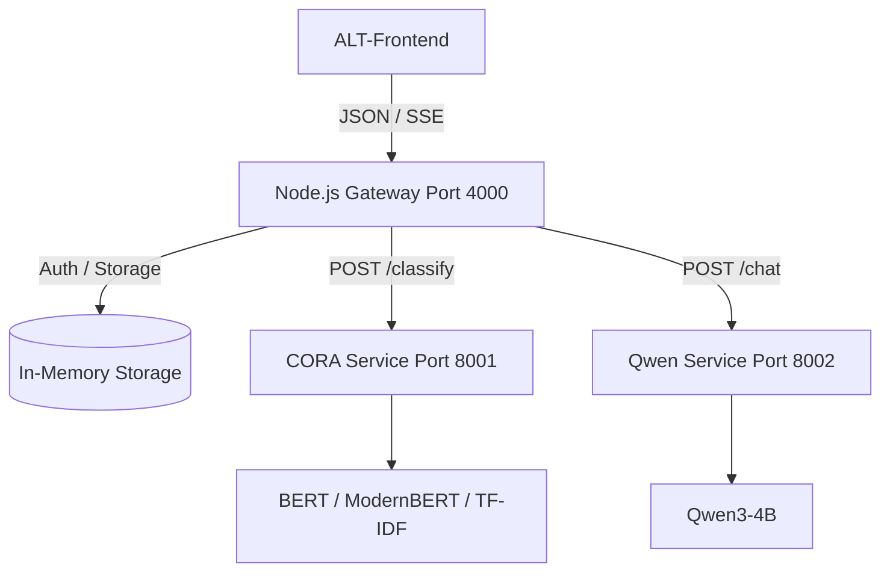

# System Architecture

## Component Separation

1. **Frontend**: Pure client application (`ALT-FrontendClaude`), completely isolated, unaltered.
2. **Backend Server**: Node.js/Express (`server/`) handling sessions, RBAC, business rule state machines, and AI service orchestration.
3. **CORA Microservice**: FastAPI service (`ai-services/cora`) providing hierarchical complaint prediction (Product -> Sub-product -> Issue -> Sub-issue).
4. **Qwen Conversational Service**: FastAPI service (`ai-services/qwen`) hosting Qwen3-4B conversational reasoning with prompt guards and banking safety policies.

